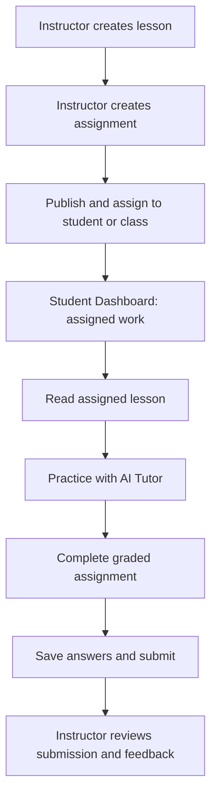

# MathPilot

**An AI-powered mathematics teaching and learning platform**

MathPilot connects instructor-created lessons and assignments with a focused student learning experience. Instructors publish and assign materials; students study, practice with a guided AI tutor, and submit their work. The goal is a reliable, end-to-end learning workflow—not a general-purpose chatbot.

> **Project scope:** This README describes the simplified MathPilot MVP workflow and intended functionality. It is a product specification, not a claim that every student feature has already been implemented.

## The MVP workflow



### 1. Instructor creates and assigns

From the existing **Instructor Dashboard / Builder**, the instructor:

1. Selects a course and topic.
2. Generates or edits a lesson with objectives, explanations, examples, and practice material.
3. Generates or edits an assignment with a chosen number and difficulty of questions.
4. Saves drafts, reviews content, and publishes approved materials.
5. Assigns the lesson and assignment to a student or class.

The current instructor creation, saved-drafts, publishing, and assignment flows should be **preserved and reused**, not rebuilt.

### 2. Student opens assigned work

The **Student Dashboard** displays only materials assigned to the authenticated student or their enrolled class:

- **My Lessons:** published lessons available to read.
- **Practice with AI Tutor:** ungraded questions connected to the lesson's topic and objectives.
- **My Assignments:** graded work with due dates (when set), progress, and submission status.

The dashboard may also summarize assigned lessons, pending assignments, and completed submissions. It should show clear empty states when no work is available.

### 3. Student studies the lesson

The student opens a lesson to view its instructor-approved objectives, explanations, mathematical notation, worked examples, and exercises. A **Practice This Topic** action opens practice associated with that lesson. Student viewing must not modify the instructor's source lesson.

### 4. Student practices with the AI Tutor

Practice is the distinctive MathPilot learning experience. Use a simple two-panel workspace:

| Mathematics workspace | AI Tutor |
| --- | --- |
| Current practice question | Context-aware guided conversation |
| Math expression input | Get Hint |
| Check Step | Explain This Step |
| Question progress / Next Question | Ask a follow-up question |

The tutor uses a **Socratic-first approach**: ask a guiding question, encourage the next step, give progressive hints, explain errors, and avoid immediately revealing final answers. It should use the current problem, lesson objectives, student input, and relevant recent context. Math expressions must render clearly using existing LaTeX/KaTeX support and, where available, MathLive input.

Practice is **ungraded** and can allow retries. Prefer existing lesson practice questions; otherwise reuse the existing question-generation service to produce separate practice questions. Do not expose restricted graded assignment answers through practice.

### 5. Student completes and submits the assignment

The **Assignment Workspace** loads the exact assignment published by the instructor. The student can:

1. Read each question and enter an answer using math-friendly input.
2. Navigate between questions.
3. Save progress and return later without losing answers.
4. Review answers and confirm final submission.
5. See a successful submission receipt and current status.

If no verified grade is available, display **Submitted — Awaiting Review** rather than inventing a score. Apply existing instructor attempt limits and tutoring permissions. The full tutor belongs in **Practice**; graded assignment assistance must respect instructor controls.

### 6. Instructor reviews results

Submitted work is persisted and linked to the student, course, and assigned activity. The instructor can review the submission using existing instructor functionality or a minimal submission-view extension, provide feedback, and use observed difficulties to improve future lessons and assignments.

## Student navigation

Keep the student experience small and consistent with the existing MathPilot interface:

1. **My Dashboard** — overview of assigned work and status.
2. **My Lessons** — read instructor-approved lessons.
3. **Practice with AI Tutor** — solve ungraded problems with guided help.
4. **My Assignments** — complete, save, and submit graded work.

Use the existing white/light-gray interface, purple accents, rounded cards, course selector, profile controls, and Student/Instructor view switch. On desktop, show practice and tutor side by side; stack them on mobile.

## Core design principles

- **Instructor-led:** the instructor owns lesson content, assignment content, publication, and assignment decisions.
- **Learning over answer-giving:** the tutor guides reasoning instead of acting as an answer dispenser.
- **Practice is separate from assessment:** unlimited guided practice must not bypass graded-assignment rules.
- **Real data:** assigned materials, saved answers, and submissions must come from persistent application data, not mock cards.
- **Reuse first:** preserve the current instructor builder, authentication, AI configuration, math rendering, and data services.
- **Simple and functional:** working buttons, clear loading/error states, and a complete workflow take priority over extra features.

## Data and integration expectations

The MVP should use the existing project's equivalent data structures and APIs. Conceptually, it needs:

```text
Student --enrolled in--> Course
Instructor --publishes--> Lesson / Assignment
Lesson / Assignment --assigned to--> Student or Class
Student --starts--> Assignment Attempt
Assignment Attempt --contains--> Saved Answers
Assignment Attempt --becomes--> Submission
Submission --reviewed by--> Instructor
```

Requirements:

- Authenticate users and authorize student/instructor actions server-side.
- Show students only content assigned to them or their class.
- Keep published source materials separate from student answers.
- Persist in-progress answers and final submissions.
- Enforce attempt limits and existing instructor tutor permissions.
- Reuse the existing AI provider through server-side calls; never expose API credentials to clients.
- Reuse mathematical verification when available; do not label uncertain AI output as independently verified.

## MVP scope

| Included in the MVP | Deferred |
| --- | --- |
| Assigned-work dashboard | Advanced analytics dashboards |
| Lesson reading | Personalized learning paths |
| Practice with guided AI Tutor | Voice tutoring |
| Math-friendly answer input | Gamification and badges |
| Assignment save/resume/submit | Real-time instructor chat |
| Submission status and instructor access | Complex multi-agent tutoring |
| Responsive UI and authorization | Automated mastery modeling |

## Implementation priorities

1. **Connect assigned content:** verify the existing instructor publishing/assignment flow and display its real records to students.
2. **Lesson reader:** reuse the existing lesson renderer and add a Practice This Topic action.
3. **Practice + Tutor:** build a compact math workspace with context-aware Socratic hints and conversation.
4. **Assignment submission:** implement persistent attempts, question navigation, save/resume, and submit.
5. **End-to-end testing:** confirm instructor → student → instructor data flow and role permissions.

## MVP acceptance checklist

- [ ] An instructor can publish and assign a lesson and assignment using the existing builder.
- [ ] The assigned student sees the correct lesson and assignment after signing in.
- [ ] The student can read the lesson with correctly rendered mathematics.
- [ ] **Practice This Topic** opens relevant, ungraded questions.
- [ ] The AI Tutor responds to the current problem with step-by-step guidance and progressive hints.
- [ ] The student can enter mathematical expressions.
- [ ] The student can start an assignment, save answers, leave, and resume.
- [ ] The student can submit once, subject to configured attempt rules.
- [ ] The submission is stored and accessible to the instructor.
- [ ] No student can access another student's private attempts or submissions.
- [ ] Existing instructor functionality continues to work.
- [ ] All visible actions, empty states, and error states behave correctly.

## Definition of success

**MathPilot MVP is successful when an instructor assigns a lesson and an assignment; the student reads the lesson, practices with the AI Tutor, completes and submits the assignment; and the instructor can review the submitted work.**

## Implementation status (working code)

Student Workspace MVP is implemented and tested (263 tests passing, 6 skipped, verified 2026-10-29):

- **Student dashboard** (`/`): real assigned-lesson/assignment cards with counts and statuses.
- **My Lessons** (`/lessons` → `/learn/{link}`): instructor-approved content, objectives, worked examples, "Practice This Topic" button.
- **Practice with AI Tutor** (`/practice`): package picker, MathLive input, two-panel workspace with Socratic feedback via the Nebius pipeline.
- **My Assignments** (`/assignments` → `/myassignments/{link}`): question navigation, save-progress with resume, final submit with confirmation; solutions never leak to student endpoints.

### Run it

```bash
py -m pip install -r requirements.txt
py -m pytest tests/ -q
py -m uvicorn app.main:app --reload   # reads .env (gitignored) for NEBIUS_API_KEY, DEMO_MODE
```

Env vars: `NEBIUS_API_KEY`, `NEBIUS_MATH_MODEL`, `NEBIUS_SOCRATIC_MODEL`, `NEBIUS_BASE_URL`, `DATABASE_URL` (default SQLite `./mathpilot.db`), `DEMO_MODE`.

That complete loop is the immediate development priority. More advanced teaching analytics and personalization can follow after it works reliably.
